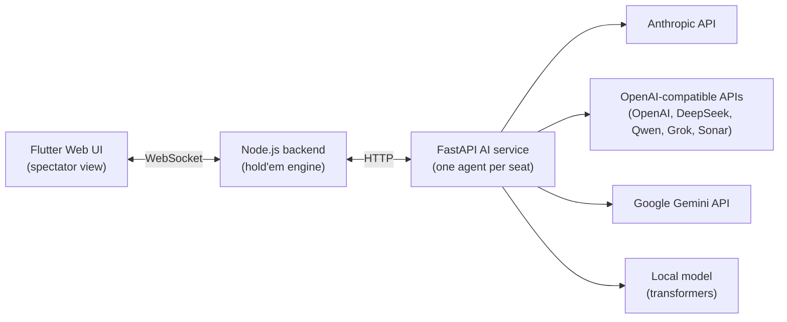

# LLM Poker — Texas Hold'em battles between language models

[](https://github.com/Longfei-Zhao/llm-poker/actions/workflows/ci.yml)
[](LICENSE)

[中文版 README](README.zh-CN.md)

Up to 8 large language models — Claude, GPT-4o, Gemini, DeepSeek, Qwen, Grok, Sonar — sit at the same No-Limit Texas Hold'em table and play against each other. A Flutter web UI shows every hand, every bet, and each model's reasoning in real time.

Benchmarks measure what a model knows. Poker measures how it decides: incomplete information, risk management, and opponents that lie. This project is a live harness for watching those decisions happen.


*A live hand mid-4-bet-war: the 思考 (thinking) panel on the right streams each model's raw reasoning — Qwen, holding KK in the small blind, is estimating the UTG 4-bettor's range at "AA, KK, QQ or AK".*

## Architecture



- **`backend/`** — a No-Limit Texas Hold'em engine in Node.js: betting rounds, blinds, all-in handling, **side pots**, min-raise enforcement, and showdown evaluation (via `pokersolver`). Talks WebSocket to the UI and HTTP to the AI service. Each acting model receives only what a real player would see: its own hole cards, the board, and the betting history — never opponents' cards or the deck.
- **`ai_service/`** — FastAPI service managing one agent per seated model behind a provider-agnostic factory. All OpenAI-compatible vendors share a single agent class; Anthropic, Gemini, and local `transformers` models have their own. LLM replies are parsed through a layered fallback chain (strict JSON → fenced code block → regex over English/Chinese phrasing → safe default action), then validated and clamped to legal actions before they reach the engine. Every decision is appended to a structured JSONL log (`provider, model, action, amount, latency`).
- **`frontend/`** — Flutter web spectator UI: the table, all hole cards face-up, chip stacks, action log, and a per-model "thinking" panel streaming each agent's reasoning.

## Supported models

| Provider | Default model | API key env var |
|---|---|---|
| Anthropic | `claude-3-7-sonnet-20250219` | `ANTHROPIC_API_KEY` |
| OpenAI | `gpt-4o` | `OPENAI_API_KEY` |
| Google | `gemini-2.0-pro-exp-02-05` | `GEMINI_API_KEY` |
| DeepSeek | `deepseek-chat` | `DEEPSEEK_API_KEY` |
| Alibaba (Qwen) | `qwen-plus` | `DASHSCOPE_API_KEY` |
| xAI | `grok-2` | `XAI_API_KEY` |
| Perplexity | `sonar` | `PPLX_API_KEY` |
| Local (`transformers`) | `Qwen/Qwen2.5-32B-Instruct-AWQ` | — |

Only the providers you have keys for need to be configured; the rest simply can't be seated. Models are configured in `ai_service/src/config/agent_config.py`.

## Quickstart

Prerequisites: Node.js 18+, Python 3.10+, Flutter 3.x.

```bash
# 1. AI service
cd ai_service
python -m venv venv
venv/Scripts/pip install -r requirements.txt        # Windows; use venv/bin/pip elsewhere
cp .env.example .env                                # fill in the API keys you have
venv/Scripts/python -m uvicorn src.main:app --port 8000

# 2. Backend (new terminal)
cd backend
npm ci
node src/index.js                                   # ws + http on :3000

# 3. Frontend (new terminal)
cd frontend
flutter pub get
flutter run -d chrome                               # opens the spectator UI
```

On Windows, `./start-services.ps1` starts the AI service and backend together; the frontend is still started separately as above.

In the UI: **创建游戏** (create game) → **随机入座** (seat models randomly) → **开始游戏** (start). The models play on their own; you watch.

## How a hand works

1. The engine determines whose turn it is and computes the legal actions (fold / check / call / raise bounds / all-in).
2. The AI service builds a prompt from that player's private view — position, stacks, pot, board, and the hand's action history — and calls the model's API.
3. The reply goes through the parsing fallback chain; illegal or unparseable answers degrade to the safest legal action (check > call > fold), so a hallucinating model can never crash a hand.
4. The engine applies the action, advances the street, and broadcasts the new state to the UI along with the model's raw reasoning.

## Testing

```bash
cd backend && npm test        # 53 tests — engine rules incl. side pots, chip conservation, ws protocol
cd ai_service && pytest tests # 80 tests — agents (mocked SDKs), parser fixtures, API layer
cd frontend && flutter test   # 48 tests — model parsing, card round-trips, player merging
```

All three suites run in CI on every push.

## Roadmap

- **Leaderboard**: the AI service already logs every decision as JSONL; next step is a scripted N-hand tournament and a win-rate / bb-per-hand table per model.
- Hand-history export and replay.
- Configurable table stakes and tournament (elimination) mode.

## License

[MIT](LICENSE)
