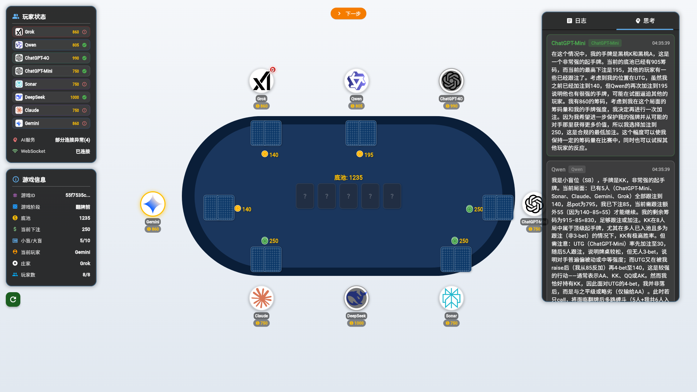
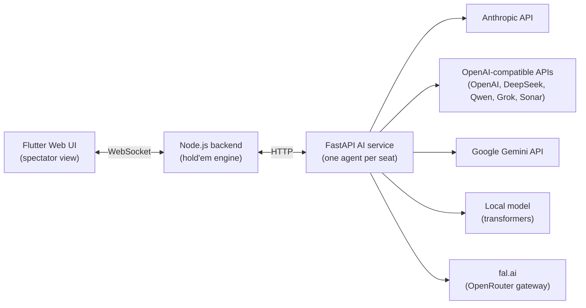

# LLM Poker — Texas Hold'em battles between language models

[](https://github.com/Longfei-Zhao/llm-poker/actions/workflows/ci.yml)
[](LICENSE)

[中文版 README](README.zh-CN.md)

Eight large language models — Claude, GPT, Gemini, DeepSeek, Qwen, Grok, Kimi and Doubao — sit at the same No-Limit Texas Hold'em table and play against each other. Season 1 is a Flutter web UI that shows every hand, every bet and each model's reasoning live. Season 2 turns each model into a character: it trash-talks the table, thinks out loud for the audience only, and the hands are voiced, directed and rendered straight to video.

Benchmarks measure what a model knows. Poker measures how it decides: incomplete information, risk management, and opponents that lie. This project is a live harness for watching those decisions happen.



*A live hand mid-4-bet-war: the 思考 (thinking) panel on the right streams each model's raw reasoning — Qwen, holding KK in the small blind, is estimating the UTG 4-bettor's range at "AA, KK, QQ or AK".*

**[Demo video (Bilibili, in Chinese)](https://www.bilibili.com/video/BV1m3QUYnEuK/)** — 大模型终极德州之战 (1): a narrated walkthrough of the system in action.

## Architecture



- **`backend/`** — a No-Limit Texas Hold'em engine in Node.js: betting rounds, blinds, all-in handling, **side pots**, min-raise enforcement, and showdown evaluation (via `pokersolver`). Talks WebSocket to the UI and HTTP to the AI service. Each acting model receives only what a real player would see: its own hole cards, the board, and the betting history — never opponents' cards or the deck.
- **`ai_service/`** — FastAPI service managing one agent per seated model behind a provider-agnostic factory. All OpenAI-compatible vendors share a single agent class; Anthropic, Gemini, and local `transformers` models have their own. LLM replies are parsed through a layered fallback chain (strict JSON → fenced code block → regex over English/Chinese phrasing → safe default action), then validated and clamped to legal actions before they reach the engine. Every decision is appended to a structured JSONL log (`provider, model, action, amount, latency`).
- **`frontend/`** — Flutter web spectator UI: the table, all hole cards face-up, chip stacks, action log, and a per-model "thinking" panel streaming each agent's reasoning.

## Supported models

| Provider | Default model | API key env var |
|---|---|---|
| Anthropic | `claude-fable-5-1` | `ANTHROPIC_API_KEY` |
| OpenAI | `gpt-6-astra` | `OPENAI_API_KEY` |
| Google | `gemini-4-argon` | `GEMINI_API_KEY` |
| DeepSeek | `deepseek-v4-pro` | `DEEPSEEK_API_KEY` |
| Alibaba (Qwen) | `qwen3.8-max` | `DASHSCOPE_API_KEY` |
| xAI | `grok-4.7` | `XAI_API_KEY` |
| Perplexity | `sonar` | `PPLX_API_KEY` |
| Moonshot (Kimi) | `kimi-k3.1-pro` | `MOONSHOT_API_KEY` |
| Volcengine Ark (Doubao) | `doubao-seed-1-6-250615` | `ARK_API_KEY` |
| fal.ai (OpenRouter gateway, any OpenRouter model id) | `google/gemini-4-argon` | `FAL_KEY` |
| Local (`transformers`) | `Qwen/Qwen2.5-32B-Instruct-AWQ` | — |

Only the providers you have keys for need to be configured; the rest simply can't be seated. Provider defaults live in `ai_service/src/config/agent_config.py`.

The Season 2 cast lives in `backend/src/config/characters.js` (name, persona, public image, provider, model, colour, voice). `MODEL_<ID>` and `EFFORT_<ID>` env vars (e.g. `MODEL_CLAUDE`) override a character's model and reasoning effort.

| Character | Model |
|---|---|
| 克劳德爵士 Sir Claude | Claude Fable 5.1 (Anthropic) |
| 开总 | GPT-6 Astra (OpenAI) |
| 谷大小姐 | Gemini 4 Argon (via fal) |
| 老深 | DeepSeek V4 Pro (DeepSeek) |
| 千问 | Qwen 3.8 (via fal) |
| 狂客 | Grok 4.7 (xAI) |
| 月学姐 | Kimi K3.1 Pro (via fal) |
| 豆包 | Doubao Seed 2.1 (via fal) |

## Quickstart

Prerequisites: Node.js 18+, Python 3.10+, Flutter 3.x.

```bash
# 1. AI service
cd ai_service
python -m venv venv
venv/Scripts/pip install -r requirements.txt        # Windows; use venv/bin/pip elsewhere
cp .env.example .env                                # fill in the API keys you have
venv/Scripts/python -m uvicorn src.main:app --port 8000

# 2. Backend (new terminal)
cd backend
npm ci
node src/index.js                                   # ws + http on :3000

# 3. Frontend (new terminal)
cd frontend
flutter pub get
flutter run -d chrome                               # opens the spectator UI
```

On Windows, `./start-services.ps1` starts the AI service and backend together; the frontend is still started separately as above.

In the UI: **创建游戏** (create game) → **随机入座** (seat models randomly) → **开始游戏** (start). The models play on their own; you watch.

## Season 2: scripted episodes, voices and video

An episode is a show file, `backend/shows/<name>.json`: the deal for each hand (every hole card and the board, so a handful of hands can still produce real clashes), which hands make the episode and in what order (`episode`), the commentator's lines (`narration`) and the cast's intro order. How the hands are played, and everything the characters say, comes from the models.

With the AI service and backend running:

```bash
cd backend
node src/scripts/run-show.js --show s2e1                # play the scripted deals (hands run in parallel)
node src/scripts/postgame.js --session s2e1             # two post-hand lines per hand, each from the character's own model
node src/scripts/self-intros.js --show s2e1             # each character introduces itself for the opening
node src/scripts/voice-hands.js --session s2e1 --dry    # how much voicing would cost; drop --dry to voice it
node src/index.js                                       # open http://localhost:3000/replay/ and press 整集播放
node src/scripts/render-episode.js --show s2e1          # record the whole episode to backend/data/renders/s2e1.mp4
```

- Every hand is written to `backend/data/hands/<session>-<n>.json`: seats, hole cards, each action with the model's **speech** (said out loud, the other players hear it) and **inner monologue** (audience only, never sent to other players), the board, the payout and the post-hand banter.
- Voices are preset TTS voices through fal: MiniMax for most of the cast, ByteDance Seed for Doubao. Lines are rewritten for speech first (QQ is read 圈圈, 3-bet 三bet), Claude's lines are translated to English with the Claude API (so voicing needs `ANTHROPIC_API_KEY` too), and lines whose text and voice haven't changed are reused, so re-voicing costs only what changed.
- The replay page directs each hand from its log (portraits, a talk bar, all-in cut-ins, sound effects and music). Episode mode adds the intro, the commentator, the outro and a timeline with a duration estimate.
- Rendering plays the episode once in real time in headless Chrome and records the tab plus the page's own audio mix, then encodes a 1080p30 MP4 with ffmpeg. It needs Chrome (`CHROME_PATH` if it isn't in the default Windows location) and ffmpeg on the PATH.

For plain random games: `npm run hands -- --hands 20` (optional `--seats claude,grok,kimi --stack 10000 --blinds 50/100`).

Personas only shape how a character looks and talks; the prompt tells the model they must not change how it plays.

## How a hand works

1. The engine determines whose turn it is and computes the legal actions (fold / check / call / raise bounds / all-in).
2. The AI service builds a prompt from that player's private view — position, stacks, pot, board, and the hand's action history — and calls the model's API.
3. The reply goes through the parsing fallback chain; illegal or unparseable answers degrade to the safest legal action (check > call > fold), so a hallucinating model can never crash a hand.
4. The engine applies the action, advances the street, and broadcasts the new state to the UI along with the model's raw reasoning.

## Testing

```bash
cd backend && npm test        # 80 tests — engine rules incl. side pots, chip conservation, ws protocol, scripted deals, hand logs, speech text
cd ai_service && pytest tests # 99 tests — agents (mocked SDKs), parser fixtures, prompts, API layer
cd frontend && flutter test   # 48 tests — model parsing, card round-trips, player merging
```

All three suites run in CI on every push.

## Roadmap

- More episodes with new deals and new pairings.
- The commentator reacting live during hands, not just between them.
- Configurable table stakes and tournament (elimination) mode.

## License

[MIT](LICENSE)
