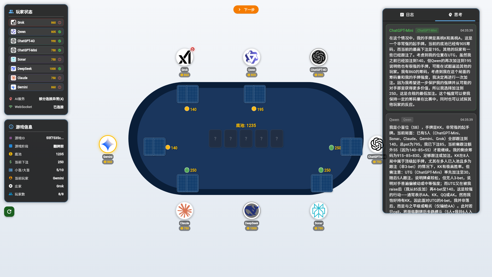
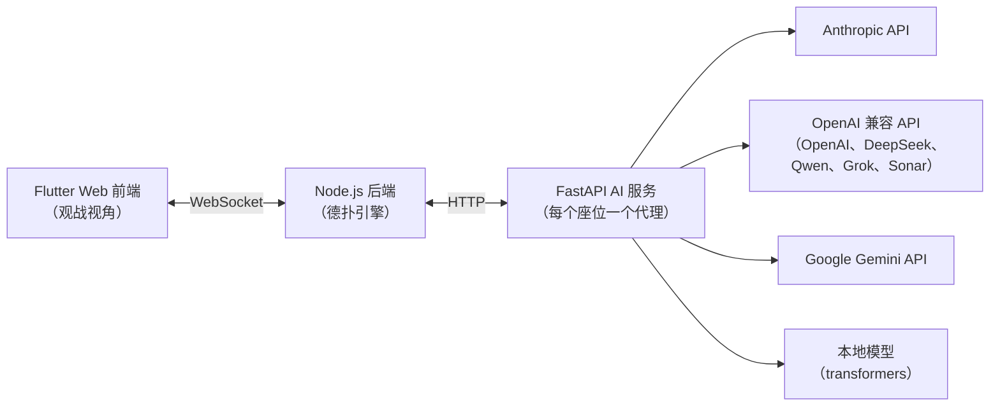

# LLM Poker — 大语言模型德州扑克对决

[](https://github.com/Longfei-Zhao/llm-poker/actions/workflows/ci.yml)
[](LICENSE)

[English README](README.md)

最多 8 个大语言模型——Claude、GPT-4o、Gemini、DeepSeek、Qwen、Grok、Sonar——同桌进行无限注德州扑克对决。Flutter Web 界面实时展示每手牌、每次下注，以及每个模型的推理过程。

基准测试衡量模型知道什么，扑克衡量模型如何决策：不完全信息、风险管理，以及会虚张声势的对手。这个项目就是一个实时观察这些决策的试验场。



*一手 4-bet 大底池进行中：右侧思考面板展示模型的原始推理——小盲位拿着 KK 的 Qwen 正在把 UTG 4-bet 玩家的范围估计为"AA、KK、QQ 或 AK"。*

**[演示视频（Bilibili）](https://www.bilibili.com/video/BV1m3QUYnEuK/)** ——《大模型终极德州之战 (1) —— 我来给AI攒个德州局》

## 系统架构



- **`backend/`** — Node.js 实现的无限注德州扑克引擎：下注轮次、盲注、全下处理、**边池**、最小加注规则、摊牌评估（基于 `pokersolver`）。通过 WebSocket 连接前端，通过 HTTP 调用 AI 服务。每个行动中的模型只能看到真实玩家能看到的信息：自己的底牌、公共牌和下注历史——绝不包含对手底牌或牌堆。
- **`ai_service/`** — FastAPI 服务，通过与提供商无关的工厂模式为每个入座模型管理一个代理。所有 OpenAI 兼容厂商共用一个代理类；Anthropic、Gemini 和本地 `transformers` 模型各有独立实现。LLM 回复经过多层降级解析（严格 JSON → 代码块 → 中英文正则 → 安全默认动作），再校验并裁剪到合法动作后才进入引擎。每次决策都会以结构化 JSONL 记录（`provider, model, action, amount, latency`）。
- **`frontend/`** — Flutter Web 观战界面：牌桌、所有明牌底牌、筹码量、行动日志，以及流式展示各模型推理的"思考"面板。

## 支持的模型

| 提供商 | 默认模型 | API 密钥环境变量 |
|---|---|---|
| Anthropic | `claude-3-7-sonnet-20250219` | `ANTHROPIC_API_KEY` |
| OpenAI | `gpt-4o` | `OPENAI_API_KEY` |
| Google | `gemini-2.0-pro-exp-02-05` | `GEMINI_API_KEY` |
| DeepSeek | `deepseek-chat` | `DEEPSEEK_API_KEY` |
| 阿里云（通义千问） | `qwen-plus` | `DASHSCOPE_API_KEY` |
| xAI | `grok-2` | `XAI_API_KEY` |
| Perplexity | `sonar` | `PPLX_API_KEY` |
| 本地（`transformers`） | `Qwen/Qwen2.5-32B-Instruct-AWQ` | — |

只需配置你有密钥的提供商，没有密钥的模型无法入座但不影响其他玩家。模型配置在 `ai_service/src/config/agent_config.py`。

## 快速开始

前置要求：Node.js 18+、Python 3.10+、Flutter 3.x。

```bash
# 1. AI 服务
cd ai_service
python -m venv venv
venv/Scripts/pip install -r requirements.txt        # Windows；其他系统用 venv/bin/pip
cp .env.example .env                                # 填入你拥有的 API 密钥
venv/Scripts/python -m uvicorn src.main:app --port 8000

# 2. 后端（新终端）
cd backend
npm ci
node src/index.js                                   # ws + http 监听 :3000

# 3. 前端（新终端）
cd frontend
flutter pub get
flutter run -d chrome                               # 打开观战界面
```

Windows 下可以用 `./start-services.ps1` 一并启动 AI 服务和后端；前端仍需按上面单独启动。

界面操作：**创建游戏** → **随机入座** → **开始游戏**。模型自动对局，你只需观战。

## 一手牌的流程

1. 引擎确定行动玩家并计算合法动作（弃牌 / 过牌 / 跟注 / 加注范围 / 全下）。
2. AI 服务根据该玩家的私有视角——位置、筹码、底池、公共牌、本手行动历史——构建提示词并调用模型 API。
3. 回复经过多层降级解析；非法或无法解析的回答会退化为最安全的合法动作（过牌 > 跟注 > 弃牌），模型幻觉不会导致牌局崩溃。
4. 引擎执行动作、推进牌面，把新状态连同模型的原始推理一起广播给前端。

## 测试

```bash
cd backend && npm test        # 53 个测试——引擎规则（含边池）、筹码守恒、ws 协议
cd ai_service && pytest tests # 80 个测试——代理（mock SDK）、解析器夹具、API 层
cd frontend && flutter test   # 48 个测试——模型解析、卡牌序列化、玩家合并
```

三个测试套件在每次 push 时由 CI 运行。

## 路线图

- **排行榜**：AI 服务已按 JSONL 记录每次决策；下一步是脚本化的 N 手锦标赛和各模型胜率 / bb per hand 统计表。
- 手牌历史导出与回放。
- 可配置盲注级别与淘汰赛模式。

## 许可证

[MIT](LICENSE)
