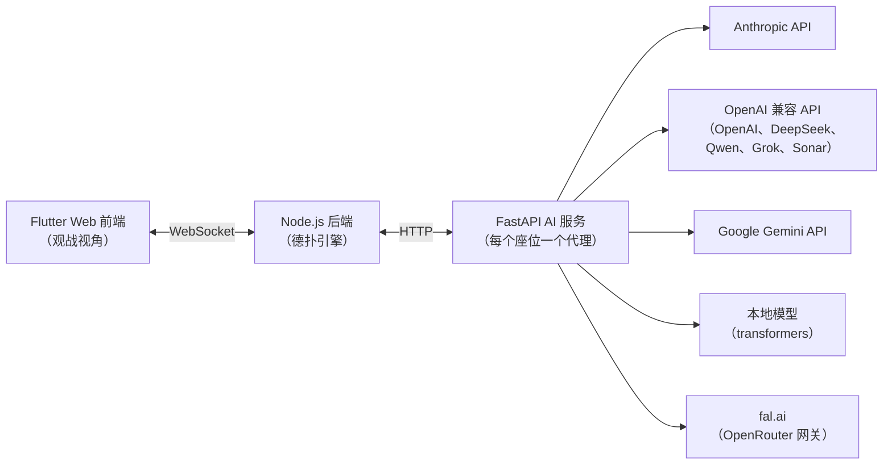

# LLM Poker — 大语言模型德州扑克对决

[](https://github.com/Longfei-Zhao/llm-poker/actions/workflows/ci.yml)
[](LICENSE)

[English README](README.md)

8 个大语言模型——Claude、GPT、Gemini、DeepSeek、Qwen、Grok、Kimi、豆包——同桌进行无限注德州扑克对决。第一季是 Flutter Web 界面，实时展示每手牌、每次下注和每个模型的推理过程；第二季把每个模型变成一个角色：在牌桌上放狠话，心声只念给观众听，每一手都配音、导演，直接渲染成视频。

基准测试衡量模型知道什么，扑克衡量模型如何决策：不完全信息、风险管理，以及会虚张声势的对手。这个项目就是一个实时观察这些决策的试验场。


*一手 4-bet 大底池进行中：右侧思考面板展示模型的原始推理——小盲位拿着 KK 的 Qwen 正在把 UTG 4-bet 玩家的范围估计为"AA、KK、QQ 或 AK"。*

**[演示视频（Bilibili）](https://www.bilibili.com/video/BV1m3QUYnEuK/)** ——《大模型终极德州之战 (1) —— 我来给AI攒个德州局》

## 系统架构



- **`backend/`** — Node.js 实现的无限注德州扑克引擎：下注轮次、盲注、全下处理、**边池**、最小加注规则、摊牌评估（基于 `pokersolver`）。通过 WebSocket 连接前端，通过 HTTP 调用 AI 服务。每个行动中的模型只能看到真实玩家能看到的信息：自己的底牌、公共牌和下注历史——绝不包含对手底牌或牌堆。
- **`ai_service/`** — FastAPI 服务，通过与提供商无关的工厂模式为每个入座模型管理一个代理。所有 OpenAI 兼容厂商共用一个代理类；Anthropic、Gemini 和本地 `transformers` 模型各有独立实现。LLM 回复经过多层降级解析（严格 JSON → 代码块 → 中英文正则 → 安全默认动作），再校验并裁剪到合法动作后才进入引擎。每次决策都会以结构化 JSONL 记录（`provider, model, action, amount, latency`）。
- **`frontend/`** — Flutter Web 观战界面：牌桌、所有明牌底牌、筹码量、行动日志，以及流式展示各模型推理的"思考"面板。

## 支持的模型

| 提供商 | 默认模型 | API 密钥环境变量 |
|---|---|---|
| Anthropic | `claude-fable-5-1` | `ANTHROPIC_API_KEY` |
| OpenAI | `gpt-6-astra` | `OPENAI_API_KEY` |
| Google | `gemini-4-argon` | `GEMINI_API_KEY` |
| DeepSeek | `deepseek-v4-pro` | `DEEPSEEK_API_KEY` |
| 阿里云（通义千问） | `qwen3.8-max` | `DASHSCOPE_API_KEY` |
| xAI | `grok-4.7` | `XAI_API_KEY` |
| Perplexity | `sonar` | `PPLX_API_KEY` |
| 月之暗面（Kimi） | `kimi-k3.1-pro` | `MOONSHOT_API_KEY` |
| 火山方舟（豆包） | `doubao-seed-1-6-250615` | `ARK_API_KEY` |
| fal.ai（OpenRouter 网关，可用任意 OpenRouter 模型名） | `google/gemini-4-argon` | `FAL_KEY` |
| 本地（`transformers`） | `Qwen/Qwen2.5-32B-Instruct-AWQ` | — |

只需配置你有密钥的提供商，没有密钥的模型无法入座但不影响其他玩家。提供商默认配置在 `ai_service/src/config/agent_config.py`。

第二季的角色在 `backend/src/config/characters.js`（名字、人设、公众形象、提供商、模型、配色、音色），可用 `MODEL_<ID>`、`EFFORT_<ID>` 环境变量（如 `MODEL_CLAUDE`）替换某个角色的模型和推理强度。

| 角色 | 模型 |
|---|---|
| 克劳德爵士 | Claude Fable 5.1（Anthropic） |
| 开总 | GPT-6 Astra（OpenAI） |
| 谷大小姐 | Gemini 4 Argon（经 fal） |
| 老深 | DeepSeek V4 Pro（DeepSeek） |
| 千问 | Qwen 3.8（经 fal） |
| 狂客 | Grok 4.7（xAI） |
| 月学姐 | Kimi K3.1 Pro（经 fal） |
| 豆包 | Doubao Seed 2.1（经 fal） |

## 快速开始

前置要求：Node.js 18+、Python 3.10+、Flutter 3.x。

```bash
# 1. AI 服务
cd ai_service
python -m venv venv
venv/Scripts/pip install -r requirements.txt        # Windows；其他系统用 venv/bin/pip
cp .env.example .env                                # 填入你拥有的 API 密钥
venv/Scripts/python -m uvicorn src.main:app --port 8000

# 2. 后端（新终端）
cd backend
npm ci
node src/index.js                                   # ws + http 监听 :3000

# 3. 前端（新终端）
cd frontend
flutter pub get
flutter run -d chrome                               # 打开观战界面
```

Windows 下可以用 `./start-services.ps1` 一并启动 AI 服务和后端；前端仍需按上面单独启动。

界面操作：**创建游戏** → **随机入座** → **开始游戏**。模型自动对局，你只需观战。

## 第二季：剧本、配音和成片

一集节目就是一个剧本文件 `backend/shows/<名字>.json`：每一手怎么发牌（每个人的底牌和公共牌，这样几手牌里也能出现真正的对撞）、成片放哪几手和顺序（`episode`）、解说的台词（`narration`）和选手登场顺序。牌怎么打、角色说什么，全由模型自己决定。

AI 服务和后端都启动后：

```bash
cd backend
node src/scripts/run-show.js --show s2e1                # 按剧本发牌跑（几手并行）
node src/scripts/postgame.js --session s2e1             # 每手结束后两句赛后感言，由角色自己的模型来说
node src/scripts/self-intros.js --show s2e1             # 片头每位选手的自我介绍
node src/scripts/voice-hands.js --session s2e1 --dry    # 估算配音费用；去掉 --dry 就开始配
node src/index.js                                       # 打开 http://localhost:3000/replay/ 点“整集播放”
node src/scripts/render-episode.js --show s2e1          # 把整集录成 backend/data/renders/s2e1.mp4
```

- 每一手都写成 `backend/data/hands/<场次>-<手数>.json`：座位、底牌、每个动作，以及模型的**台词**（说出口，其他人听得到）和**心声**（只给观众看，绝不会发给其他玩家）、公共牌、结算和赛后感言。
- 配音用 fal 上现成的预设音色：大部分角色用 MiniMax，豆包用字节的 Seed。配音前先把文字转成念法（QQ 念圈圈、3-bet 念三bet）；克劳德爵士的台词先用 Claude API 翻成英文再念（所以配音也需要 `ANTHROPIC_API_KEY`）。文字和音色都没变的句子直接复用，重配只花改动部分的钱。
- 回放页按记录自己导演每一手（立绘、底部对话栏、全下特写、音效和音乐）。整集模式再加上片头、解说、片尾，以及带时长估算的时间轴。
- 渲染时用无头 Chrome 实时把整集放一遍，录下标签页画面和页面自己的混音，再用 ffmpeg 转成 1080p30 的 MP4。需要 Chrome（不在 Windows 默认位置时设 `CHROME_PATH`）和 PATH 里的 ffmpeg。

只想随机跑几手：`npm run hands -- --hands 20`（可选 `--seats claude,grok,kimi --stack 10000 --blinds 50/100`）。

人设只决定形象和说话方式，prompt 里明确要求不许影响打法。

## 一手牌的流程

1. 引擎确定行动玩家并计算合法动作（弃牌 / 过牌 / 跟注 / 加注范围 / 全下）。
2. AI 服务根据该玩家的私有视角——位置、筹码、底池、公共牌、本手行动历史——构建提示词并调用模型 API。
3. 回复经过多层降级解析；非法或无法解析的回答会退化为最安全的合法动作（过牌 > 跟注 > 弃牌），模型幻觉不会导致牌局崩溃。
4. 引擎执行动作、推进牌面，把新状态连同模型的原始推理一起广播给前端。

## 测试

```bash
cd backend && npm test        # 80 个测试——引擎规则（含边池）、筹码守恒、ws 协议、剧本发牌、手牌记录、配音文字转换
cd ai_service && pytest tests # 99 个测试——代理（mock SDK）、解析器夹具、prompt、API 层
cd frontend && flutter test   # 48 个测试——模型解析、卡牌序列化、玩家合并
```

三个测试套件在每次 push 时由 CI 运行。

## 路线图

- 更多集：新的发牌、新的对阵。
- 解说在牌局进行中实时点评，而不只是在两手之间。
- 可配置盲注级别与淘汰赛模式。

## 许可证

[MIT](LICENSE)
